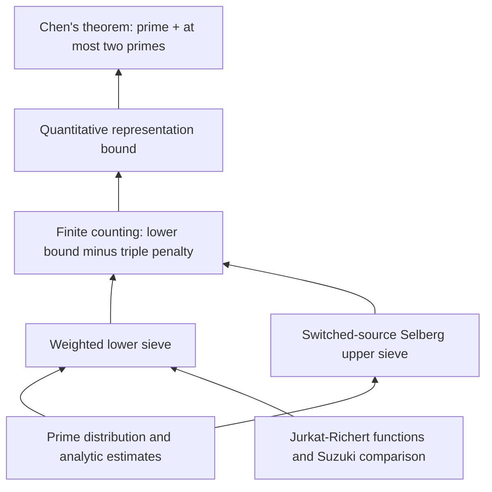

# Explicit Chen's theorem in Lean

This fork of [subfish-zhou/goldbach-lean](https://github.com/subfish-zhou/goldbach-lean)
develops an explicit numerical Chen theorem, conditional on the single local
hypothesis `ChenEffective.dirichlet_seven_eighths`. The original project's
formalizations and attribution are retained below.

## Current explicit result and trust boundary

The active theorem proves that every even natural number

\[
N\ge N_0=3^{3^{171}}
\]

is the sum of a prime and either another prime or a product of two primes.
Writing `N0 = exp(exp(H))`, the verified cutoff has `H` approximately
**187.956749**. See [the theorem](research/chen-bjs-study/BJSStudyChen.lean),
[the exact recovery of the original implicit Chen statement](research/chen-bjs-study/BJSStudyCompatibility.lean),
and [the explicit development and checking instructions](research/chen-bjs-study/README.md).

This result is conditional: the sole additional axiom is the local Dirichlet
seven-eighths hypothesis, alongside Lean's standard axioms. The active proof
has no BJS axioms, OpenAI module imports, `sorry`/`admit`, `native_decide`, or
unsafe proof declarations. No new external Lake dependencies or toolchain
changes were introduced. The analytic input and final theorem have separate
transitive proof audits; see [the analytic package](research/chen-dusart/README.md).
Historical research files and numerical studies are not all active theorem
inputs; their status must be read separately.

The current proof combines proved BJS-style sieve ingredients with our own
explicit distribution and Selberg-square/triple estimates. It is not a full
formalization of BJS's numerical application, and does not claim their cutoff.
Reducing the cutoff requires sharper small-endpoint prime products, arithmetic
progression/distribution remainders, and square/triple error estimates, with a
joint end-to-end budget. The stronger earlier counting theorem retains its
separate, larger cutoff.

## Approach

The current proof establishes the exact cutoff

$$
N_0=3^{3^{171}},\qquad
H=\log\log N_0=171\log3+\log\log3\approx187.956749.
$$

For every even integer $N\ge N_0$, it proves $N=p+q$, where $p$ is prime
and $q$ is prime or a product of two primes. The argument bounds a weighted
candidate count from below and a triple penalty from above, then applies an
exact finite counting inequality. All logarithms below are natural.

### 1. A single zero-free hypothesis makes the analytic estimates effective

The sole additional axiom says, for every Dirichlet character $\chi$ at any
positive modulus,

$$
\Re s>\frac78,\quad (\chi,s)\ne(\mathbf1,1)
\quad\Longrightarrow\quad L(s,\chi)\ne0.
$$

For every $\eta>0$ and primitive nonprincipal quadratic character of conductor
$q$, a proved consequence replaces an ineffective Siegel bound by

$$
\Re L(1,\chi)\ge c(\eta)q^{-\eta},\qquad
\varepsilon=\min\left(\frac1{16},\frac{\eta}{8}\right),\qquad
c(\eta)=\frac{\varepsilon}{4\cdot648^{4\varepsilon}}.
$$

This feeds the numerical low-conductor, principal prime number theorem, and
prime-distribution estimates. See [ExplicitSiegel.lean](research/chen-effective/ExplicitSiegel.lean).

### 2. The explicit formula supplies the prime-product input

The analytic development proves a numerical weighted zeta-zero moment bound,
then the smoothed explicit-formula estimate

$$
\left|\psi_1(x)-\frac{x^2}{2}\right|\le0.121x^{15/8}
\quad(x\ge3^{100}),\qquad
\psi_1(x)=\sum_{n\le x}(x-n)\Lambda(n).
$$

Unsmoothing and removing prime powers give

$$
|\theta(x)-x|\le\frac34x^{15/16}\le\frac{4x}{\log^2x}
\qquad(x\ge3^{120}).
$$

Partial summation then yields, with $M_P$ the prime reciprocal Mertens constant,

$$
\left|\sum_{p\le x}\frac1p-\log\log x-M_P\right|
\le\frac1{2\log^2x}\qquad(x\ge3^{120}),
$$

and the ordered interval estimate

$$
\sum_{a\le p\le b}\frac1p
\le\log\frac{\log b}{\log a}+\frac1{\log^2a}
\qquad(3^{120}\le a\le b).
$$

Consequently, with $U=3^{120}$, the Goldbach sieve product satisfies

$$
\prod_{u\le p<z}\frac{p-1}{p-2}
\le\left(1+\frac1{4000}\right)\frac{\log z}{\log u}
\qquad(U\le u\le z).
$$

Products and sums in these formulas run over primes. The formal product theorem
also handles subsets of the primes and the required endpoint conventions.
See [the analytic application](research/chen-dusart/DusartPort/Application.lean)
and [the product proof](research/chen-bjs-study/BJSStudyProducts.lean).

### 3. Certified BJS-style sieve bounds estimate the counting sets

For sieve level $D$, sifting endpoint $z$, and $s=\log D/\log z$, the proved
density estimates, in their respective parameter windows, have the form

$$
\text{lower main sum}\ge V(z)\bigl[f(s)-0.055e^2h(s)\bigr],
$$

$$
\text{upper main sum}\le V(z)\bigl[F(s)+0.055e^2h(s)\bigr].
$$

Here $f,F$ are the linear-sieve functions, $h$ is the error hat function, and
$V(z)$ is the local sieve product. The coefficient $0.055=220/4000$ comes
from certified early layers, an analytic tail, discrete induction, and parity
sums. These statements are for normalized Rosser main sums; the corresponding
counting estimates also pay source-mass and distribution remainders.

Pre-sieving costs distribution level. For the removed small-prime product $Q$,
we prove $\log Q\le2U$. Our cutoff ensures

$$
\log N\ge10^{20}(1+2U),
$$

which makes the resulting sieve-coordinate shift at most $10^{-7}$.
See [the density adapters](research/chen-bjs-study/BJSStudyInputs.lean) and
[the geometry bounds](research/chen-bjs-study/BJSStudyGeometry.lean).

### 4. Base and medium-prime estimates give the weighted lower bound

Use the singular-series normalization

$$
\mathfrak S(N)=
\prod_{p>2}\left(1-\frac1{(p-1)^2}\right)
\prod_{\substack{p\mid N\\p>2}}\frac{p-1}{p-2},
\qquad M(N)=\mathfrak S(N)\frac{N}{\log^2N}.
$$

We prove $\mathfrak S(N)\ge1/2$. Let $A(N)$ be the source candidate count
and $B(N)$ its medium-prime aggregate, over $N^{1/10}<q\le N^{1/3}$. The
proved estimates are

$$
A(N)\ge\left(a-\frac1{20}\right)M(N),\qquad
B(N)\le\left(b+\frac{113}{100}\right)M(N),
\qquad a-\frac b2\ge2.6408.
$$

Here $a,b$ are the certified main coefficients. After correcting endpoints
and repeated-prime-power contributions, at cost at most $M(N)/20000$, the
actual valuation-weighted count satisfies

$$
W(N)\ge\left(2.6408-\frac1{20}-\frac{113}{200}-\frac1{20000}\right)M(N)
=2.02575M(N).
$$

See [the base bound](research/chen-bjs-study/BJSStudyBase.lean),
[the medium-prime aggregate](research/chen-bjs-study/BJSStudyAggregate.lean),
and [the weighted lower bound](research/chen-bjs-study/BJSStudyLower.lean).

### 5. The Selberg-square argument bounds the triple penalty

Our current triple producer proves

$$
T(N)\le3.94033M(N)+10^{40}\frac{N}{\log^3N}.
$$

This uses our Selberg-square route rather than BJS's complete switched triple
argument. A critical denominator estimate is

$$
\frac{\bigl(2\,\mathrm{AbsLogMoment}(N)+\mathrm{AbsMass}(N)\bigr)
\mathfrak S(N)}{\log N}\le10^{-12},
$$

where the two absolute moments belong to the Selberg correction coefficients.
The cutoff also pays the triple remainder:

$$
10^{40}\frac{N}{\log^3N}\le0.01M(N),\qquad
T(N)\le3.95033M(N).
$$

See [the denominator estimate](research/chen-bjs-study/BJSStudySelbergDenominator.lean)
and [the triple bound](research/chen-bjs-study/BJSStudyTriple.lean).

### 6. An exact finite counting inequality finishes the proof

If $R(N)$ counts valid Chen representations by their prime first summand,
the combinatorial bridge proves

$$
R(N)\ge W(N)-\frac12T(N).
$$

Therefore

$$
R(N)\ge\left(2.02575-\frac{3.95033}{2}\right)M(N)
=0.050585M(N)>0.
$$

A positive count gives the required representation. The
[final theorem](research/chen-bjs-study/BJSStudyChen.lean) and
[compatibility theorem](research/chen-bjs-study/BJSStudyCompatibility.lean)
also recover the exact original implicit Chen statement. The audited proof
uses only the stated Dirichlet axiom and Lean's standard axioms, with no BJS
axioms, placeholders, `native_decide`, unsafe proof declarations, or OpenAI
imports.

## References, source provenance, and acknowledgments

This work builds on and was informed by the following projects and papers.
We distinguish adapted Lean source from mathematical references and studies:

- **Upstream formalization:** [subfish-zhou/goldbach-lean](https://github.com/subfish-zhou/goldbach-lean)
  supplies the original Chen development and reusable analytic number theory.
  This fork preserves its history, source attribution, and license.
- **Adapted analytic source:** [AlexKontorovich/PrimeNumberTheoremAnd (PNT+)](https://github.com/AlexKontorovich/PrimeNumberTheoremAnd)
  and [sthubbar/lean-lab-preprints](https://github.com/sthubbar/lean-lab-preprints)
  supply selectively adapted Hadamard factorization, explicit-formula,
  zero-counting, and related analytic proofs. These are local source ports,
  checked with this repository's toolchain, rather than new package dependencies.
  Exact pinned revisions, file provenance, original copyright headers, and
  Apache-2.0 notices are retained in
  [the source notice](research/chen-dusart/NOTICE.md) and
  [the provenance manifest](research/chen-dusart/provenance.json).
  A Mathlib functional-equation derivative is also locally backported and
  credited there.
- **Consulted formalization:** [teorth/IEANTN](https://github.com/teorth/IEANTN)
  was examined for explicit analytic number theory inputs and proof approaches.
  This acknowledgment does not claim a complete port of that project.
- **Explicit sieve reference:** Matteo Bordignon, Daniel R. Johnston, and
  Valeriia Starichkova (BJS),
  [An explicit version of Chen's theorem and the linear sieve](https://arxiv.org/abs/2207.09452).
  Our certified sieve layers, recurrence, induction, and parity bounds draw on
  this work. The cited paper proves a cutoff `exp(exp(32.7))`; its complete
  numerical application is not yet reproduced here.
- **Earlier explicit Chen work:** Tomohiro Yamada,
  [Explicit Chen's theorem](https://arxiv.org/abs/1511.03409), provided motivation
  and a comparison point. The threshold claimed there is not assumed as an
  input to our Lean proofs.
- **Other mathematical inputs:** Chen's theorem, Jurkat-Richert sieve methods,
  Suzuki's sieve comparisons, Selberg's upper sieve, and Dusart's explicit
  prime estimates inform the development. Our local Dusart-related application
  proves the restricted bounds it needs under the permitted Dirichlet
  hypothesis; it does not claim to formalize all of Dusart's results.
- **Hypothesis motivation:** OpenAI's
  [QuasiRiemannHypothesis challenge](https://github.com/openai/math/blob/main/lean/ComparatorChallenges/QuasiRiemannHypothesis.lean)
  and [DirichletSevenEighths challenge](https://github.com/openai/math/blob/main/lean/ComparatorChallenges/DirichletSevenEighths.lean)
  motivated the local hypothesis. No OpenAI repository modules are imported,
  and the local Dirichlet hypothesis remains explicitly axiomatic here.

The original [Apache-2.0 license](LICENSE) and adapted-source notices are retained.
The upstream README follows; its broader Li-Liu and Wu developments are distinct
from this fork's explicit numerical Chen branch.

---
# goldbach-lean

A Lean 4 project formalizing progress toward **Goldbach's conjecture** and
building reusable analytic number theory, with **Chen's 1+2 theorem** and
**Li–Liu's 1+1.9 theorem** formalized. The separate
[Wu04/Wu08 development](research/wu2008/README.md) derives **1+1.8938**;
its full source build, statement and axiom checks, and final module kernel
replay have passed.

The Li–Liu result proves:

> Every sufficiently large even natural number has a representation
> `N = p + r*q`, where `p` and `q` are prime, `r = 1` or `r` is prime, and
> `r^10 ≤ q^9`.

It also proves the strict `0.0004` lower bound for the number of distinct prime
first summands satisfying this condition, in the Liu singular-series normalization.
The earlier **1+2** result remains available through its original import and
public names: every sufficiently large even natural number is a prime plus
another prime or a product of two primes, whose factors may be equal.

The [release notes](docs/RELEASE_NOTES.md) describe the new results and retain the
historical v1.0.0 record. The [source-size report](docs/SOURCE_SIZE.md) gives the
current theorem import-closure sizes and measured refactoring changes.
The [structural Chen audit](docs/CHEN_REDUNDANCY_AUDIT.md) records a net saving
of 115,586 effective main-library lines. The subsequent
[comparison with five original papers](docs/CHEN_PAPER_COMPARISON.md)
shares three finite Selberg optimizer proofs and saves another 598 lines.
The current Chen import closure contains 99,214 effective code lines.
The [implemented Li–Liu cleanup](docs/LILIU_CLEANUP.md) follows the
[original-paper audit](docs/LILIU_REDUNDANCY_AUDIT.md), unifies the count and
existence routes, removes duplicate certificates and separates generic sieve
factors from Chen applications. Two waves saved 30,897 main-library lines. The
[continuity follow-up](docs/LILIU_CONTINUITY_CLEANUP.md) saves another 60 lines
using existing one-sided-neighborhood lemmas. The
[shared-foundation follow-up](docs/LILIU_LOG_KERNEL_CLEANUP.md) saves another
11 main lines and 1,086 Li–Liu import-closure lines, counting both
new modules and all moved code. The
[finite-cell calculus follow-up](docs/LILIU_GRID_CALCULUS_CLEANUP.md) shares integration
and convergence arguments across six grids and saves another 89 main lines.
The [shared-lemma follow-up](docs/LILIU_SHARED_LEMMA_CLEANUP.md) removes another
84 production lines and drops redundant evenness assumptions from three internal
Euler positivity statements. The
[local-product follow-up](docs/LILIU_PRODUCT_CLEANUP.md) shares the uniform sieve-product
witness and normalized error payments, saving another 192 lines including its
new shared module. The [carrier and growth follow-up](docs/LILIU_CARRIER_CLEANUP.md)
shares exact carrier and scale-membership proofs and uses Mathlib's finite-fiber
bound, saving another 154 main lines including all moved bodies and imports.
The [endpoint follow-up](docs/LILIU_ENDPOINT_CLEANUP.md) shares exact endpoint
positivity, floor-scale and large-divisor bounds, saving another 78 main lines
including all moved proof bodies. The [low-conductor/Pan follow-up](docs/LILIU_LOW_BUDGET_CLEANUP.md)
shares the generic low-conductor budget and Pan maximum bound, saving another
187 main lines, counting all shared code. The [finite coprimality-gate follow-up](docs/LILIU_GATE_BUDGET_CLEANUP.md)
lets B10 specialize G11's general finite-support estimate, saving another 181 lines,
including all 116 lines in the new common provider. The
[finite-helper follow-up](docs/LILIU_FINITE_HELPER_CLEANUP.md) reuses existing finite-sum,
log-payment and inclusive grid bounds, saving another 34 main lines with all moved
code counted. The [boundary-integral follow-up](docs/LILIU_BOUNDARY_INTEGRAL_CLEANUP.md)
shares the exact B9/G9 excess-cover estimates and low-integral positivity, saving
another 127 lines with all moved code counted. The
[quartic-log follow-up](docs/LILIU_QUARTIC_LOG_CLEANUP.md) shares B10/S2's identical
quartic remainder payment, saving another 16 main/Li–Liu lines including its full
shared proof. Chen's source closure grows by 16 lines through that shared provider.
The [shared-calculus follow-up](docs/LILIU_SHARED_CALCULUS_CLEANUP.md) reuses the
original G11 derivative/Fubini proofs and global author-weight cap, and simplifies
two complex-power identities, saving another 27 main/Li–Liu lines and 6 Chen lines.
The [finite-prefix follow-up](docs/LILIU_FINITE_PREFIX_CLEANUP.md) shares the original
squarefree-divisor and sorted-prefix proofs, saving another 66 main/Li–Liu lines
and 49 Chen lines.
Current main size: 201,756 effective lines; current Li–Liu import closure:
194,201 lines.
The [recorded build benchmarks](docs/BUILD_BENCHMARK.md)
measure the v1.0.0-rc1 and v1.0.0 **1+2** developments.

**[Project homepage](https://subfish-zhou.github.io/goldbach-lean/)**
· **[Lean API documentation](https://subfish-zhou.github.io/goldbach-lean/docs/)**
· **[Interactive proof Blueprint](https://subfish-zhou.github.io/goldbach-lean/blueprint/)**

The Lean API documentation covers all four project libraries, with declaration
search, source links, and import navigation. The complete local publication
layout includes the Li–Liu mathematical proof structure and paper correspondence
at `/report/`. Optional dependency panels in the Blueprint and API expose the
compiled dependency data from internal static assets. See [how the website is built and published](docs/DOCUMENTATION.md).

| Read the mathematics | Explore the proof | Check the result |
|---|---|---|
| [Theorems and normalization](docs/THEOREMS.md) | [Architecture and source map](docs/ARCHITECTURE.md) | [Verification and trust boundary](docs/VERIFICATION.md) |

## Proof at a glance

The following roadmap describes the Chen 1+2 route. The Li–Liu extension has
its own [public entry and source route](docs/ARCHITECTURE.md#liliu-extension).



This is a mathematical roadmap: arrows point from an input to the result it
supports, and may summarize several modules. The [source map](docs/ARCHITECTURE.md)
separates this view from direct imports and compiled declaration dependencies.

The [interactive Blueprint](https://subfish-zhou.github.io/goldbach-lean/blueprint/)
renders selected declaration dependencies from LeanArchitect, with links to their
Lean source. This curated mathematical view is distinct from the module import
graph and the compiled declaration graph available through these panels. Imports
record module access; only the separate compiled `value` references record
actual static uses within stored proofs or definitions. The declaration graph
also keeps `type` and `recursorRHS` references separate.

The release procedure for this documentation update builds and validates the
complete static site locally, then publishes it independently to `gh-pages`
from a fresh staging checkout. Lean CI retains the full warning-free build, source/statement/axiom
checks, script tests, and replay of `Goldbach.Theorem`, `Goldbach.Checks`,
`Goldbach.OnePlusOneNine`, `Goldbach.OnePlusOneNineChecks` and `Goldbach.All`;
it does not generate or deploy the website. A reused API artifact may document
an earlier source version than the website: record both exact revisions and
preserve the API's original source links. Follow the
[deployment procedure](docs/DOCUMENTATION.md#regression-tests-and-deployment)
and read back the live build records after Pages deploys to determine which
version is online.

## Main results

The two developments have separate imports over shared analytic foundations.
Use `import Goldbach` for the established 1+2 interface,
`import Goldbach.OnePlusOneNine` for 1+1.9, or `import Goldbach.All` for both.

```lean
import Goldbach.OnePlusOneNine

#check Goldbach.one_plus_one_nine
#check Goldbach.one_plus_one_nine_real
#check Goldbach.one_plus_one_nine_count
#check Goldbach.one_plus_one_nine_lower_bound
```

The natural-power theorem retains the exact `r^10 ≤ q^9` condition; the real-power
version states `r ≤ q^((19/10 : ℝ) - 1)`. The count theorem gives
`(1/2500) * liuSingularSeries N * N / (Real.log N)^2 < D19 N`, where `D19`
counts different eligible primes `p`. The stronger lower-bound family allows
each fixed real `κ < 515093/800000000`, with a threshold depending on `κ`.
See [the precise statements and normalization](docs/THEOREMS.md).

The original Chen interface is unchanged:

```lean
import Goldbach

#check Goldbach.chen_theorem
#check Goldbach.representation_lower_bound
```

`Goldbach.chen_theorem` proves `Goldbach.ChenTheorem`. The specification in
[`Goldbach/Statement.lean`](Goldbach/Statement.lean) is deliberately independent
of the sieve implementation:

```lean
∃ N₀ : ℕ, ∀ N : ℕ, N₀ ≤ N → Even N →
  ∃ p q : ℕ, p.Prime ∧
    (q.Prime ∨ ∃ r s : ℕ, r.Prime ∧ s.Prime ∧ q = r * s) ∧ N = p + q
```

The quantitative theorem gives an eventual lower bound of
`0.67 * liuSingularSeries N * N / (Real.log N)^2` for the cardinality of the
actual good-representation set, for even `N`. See
[`docs/THEOREMS.md`](docs/THEOREMS.md) for definitions and normalization.

## Wu04/Wu08: 1+1.8938

The self-contained [research development](research/wu2008/README.md) has its own
source manifest, build driver, and acceptance checks. Its final module is
[`WR2ClassicalCertificate`](research/wu2008/src/WR2ClassicalCertificate.lean),
whose theorem `WuPaper.ClassicalSlots.one8938` states that every sufficiently
large even `N` has `N = p + r*q`, with `p` and `q` prime, `r = 1` or prime,
and `r^5000 ≤ q^4469`. The previous `one894` interface is retained.

The complete 4,151-module research scope, independent literal statement and axiom
checks, and final module kernel replay have passed. The production receipt check
reuses 3,500 actual compiled source proofs and verifies 651 unchanged dependencies.
Follow the research README for separate verification commands and acceptance records.
The latest [structural compression](docs/WU_STRUCTURAL_COMPRESSION.md) saves 7,612
effective lines while preserving precision and budgets. The final theorem import
closure now contains 525,529 effective lines, 601,107 fewer than the original version.
The preceding [LiuPan lemma pruning](docs/WU_LIUPAN_PRUNING.md) remains a historical
accepted phase with 383 removed declarations and 10,924 lines saved.

The [paused next Hf4 candidate](research/wu-hf4-constructive-wip/README.md) is
preserved separately with its producer and partial verification evidence; it is
excluded from the accepted totals above.

## Build and check

Install [elan](https://github.com/leanprover/elan), then run from this directory:

```sh
unset LEAN_PATH LEAN_SRC_PATH
lake exe cache get
lake --wfail build
python3 scripts/check.py
lake env lean Goldbach/Checks.lean
lake env leanchecker --verbose Goldbach.Theorem
```

The toolchain and all Git dependencies are pinned by `lean-toolchain` and
`lake-manifest.json`. The checkout contains the complete local source closure.
`lake exe cache get` downloads Mathlib's compiled cache; the project proofs are
built from source. `scripts/check.py` runs separate statement and axiom probes
for Chen 1+2 and Li–Liu 1+1.9. `Goldbach/Checks.lean` retains the Chen checks;
`Goldbach/OnePlusOneNineChecks.lean` checks the new interface. The `leanchecker`
command above replays the Chen public module against cached imports. The
[verification guide](docs/VERIFICATION.md) gives the Li–Liu inspection and replay
commands as well.

The checks reject proof placeholders and custom axioms in the shipped source,
verify the public theorem axiom reports against Lean's standard classical
axioms (`propext`, `Classical.choice`, `Quot.sound`), and check source hygiene.
Read [`docs/VERIFICATION.md`](docs/VERIFICATION.md) for the exact coverage and
limitations.

### Focused builds and upgrading an existing checkout

```sh
lake build Goldbach.Theorem          # Chen 1+2
lake build Goldbach.OnePlusOneNine   # Li–Liu 1+1.9
lake build Goldbach.All              # both public interfaces
lake build                          # full project
```

If you have already built the project, keep `.lake/` and update your checkout
without cleaning it. To update an existing `main` checkout:

```sh
git switch main
git pull --ff-only
lake build Goldbach.OnePlusOneNine
```

To use the integration branch instead, run `git fetch origin`, then
`git switch integrate/liliu19-latest`. If that branch is not yet local, use
`git switch --track origin/integrate/liliu19-latest` instead. Preserve or commit
any local work before switching branches.

The package configuration, toolchain and dependency pins are unchanged. Lake
can reuse unchanged dependency artifacts and rebuilds new or changed modules
and affected consumers as needed. Keep the existing `.lake/` directory; rebuild
work depends on your cache state and selected target.

## Organization

- `Goldbach/`: independent statement, public theorems, and acceptance checks.
- `MathlibNt/`: Chen and Li–Liu sieve and analytic proof implementations.
- `AnalyticNumberTheory/`: reusable prime-distribution, Mertens, and sieve results.
- `PrimeNumberTheoremAnd/`: the attributed, adapted prime-number-theorem source closure.
- `scripts/`: reproducible source and trust checks.
- `docs/`: theorem map, architecture, provenance, and verification instructions.
- `research/wu2008/`: the separately built and accepted Wu04/Wu08 1+1.8938 proof.

The proof uses a modern combination of Jurkat–Richert/Richert linear sieve,
Suzuki comparison results, Selberg upper sieve, and proved distribution bounds.
The [architecture guide](docs/ARCHITECTURE.md) explains how these ingredients
combine to prove the public results.

## Sources and license

Distributed under Apache-2.0. Upstream copyright notices are retained.
This project builds on `UyNewNas/chen-theorem-lean`,
`UyNewNas/analytic-number-theory-lean`, Mathlib, and the adapted source closure
of `AlexKontorovich/PrimeNumberTheoremAnd`. Attribution is described in
[`docs/PROVENANCE.md`](docs/PROVENANCE.md).
